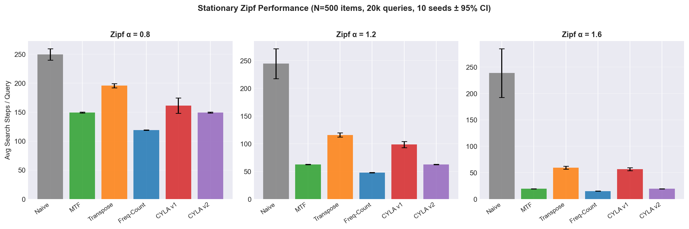
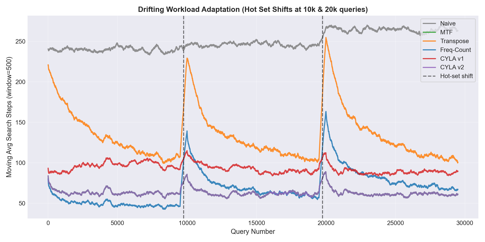
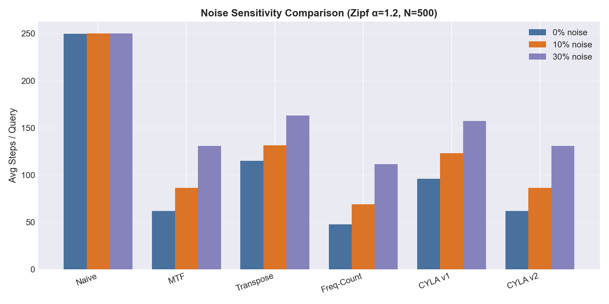

<div align="center">
  

  # Cyla
  **Self-organizing adaptive list with online SGD scoring and cold-gated Move-to-Front.**

  [](test.py)
  [](https://www.python.org/)
  [](requirements.txt)
  [](LICENSE)
</div>

---

## Status

Research / learning project. The learned scoring component did not outperform strong classical baselines in the final evaluation.

This repository is maintained as an open-access, fully reproducible negative-result study. Across 8.1 million simulated queries across stationary, drifting, and noisy access distributions, adding online neural scoring to self-organizing lists produced no empirical advantage over classic Move-to-Front (MTF) while introducing substantial computational overhead.

---

## Goal

Explore whether a lightweight online neural scorer could improve upon Move-to-Front on non-stationary and noisy access patterns, while preserving theoretical competitiveness on hot items.

The experiment was designed to test two specific hypotheses:
1. Could an online gradient descent model learn recency, frequency, and item age dynamics in real time to reorder elements more efficiently than heuristic policies (Move-to-Front, Transpose, Frequency-Count)?
2. Could cold-start gating and noise filtering protect list order from cache thrashing during non-stationary phase shifts and singleton query bursts without losing the $2$-competitive guarantee of MTF?

---

## What was built

- **Adaptive list with cold-gated re-ranking**: A list container where hot items ($count > 0$) strictly preserve their Move-to-Front relative order, while cold items ($count == 0$) inside a prefix window ($k = \lfloor 0.22 \times N \rfloor$) are scored and sorted by a neural model.
- **Pure NumPy online SGD micro-engine (`CylaX1`)**: A single-hidden-layer perceptron ($\text{Linear}(5 \to 12) \to \tanh \to \text{Linear}(12 \to 1)$) trained with online stochastic gradient descent, momentum ($0.90$), and weight clipping ($\pm 7.0$) using hand-derived analytic backpropagation.
- **Cold-start and noise-handling mechanisms**: A noise guard threshold (`min_evidence`) intended to suppress promotions caused by one-off singleton queries while permitting initial item discovery.
- **Full benchmark suite**: A multi-regime evaluation harness testing 6 algorithmic approaches over 8.1 million total query operations across stationary Zipf distributions, non-stationary concept drift, and uniform noise injection.

---

## Results

### 1. Stationary Zipf Workload

Evaluated on $N = 500$ items across 20,000 queries per run over 10 random seeds (95% confidence intervals). Competitive ratio is reported relative to the offline static frequency-optimal ordering (OPT).

| Algorithm | $\alpha = 0.8$ (Avg Steps) | $\alpha = 1.2$ (Avg Steps) | $\alpha = 1.6$ (Avg Steps) | Comp. Ratio vs OPT ($\alpha=1.6$) |
|:---|:---:|:---:|:---:|:---:|
| **Naive (Static)** | 249.6 ± 10.0 | 244.5 ± 27.0 | 238.8 ± 46.1 | 21.10× |
| **Transpose** | 195.8 ± 3.7 | 115.8 ± 3.7 | 59.4 ± 2.9 | 5.24× |
| **CYLA v1 (Unbounded)** | 161.2 ± 13.3 | 98.5 ± 5.7 | 56.7 ± 2.9 | 5.00× |
| **Freq-Count (Sort by Count)** | 119.0 ± 0.5 | 47.7 ± 0.4 | 15.1 ± 0.1 | 1.33× |
| **MTF (Sleator & Tarjan)** | 149.3 ± 0.8 | 62.5 ± 0.5 | 19.5 ± 0.2 | 1.72× |
| **CYLA v2 (Cold-Gated)** | **149.3 ± 0.8** | **62.5 ± 0.5** | **19.5 ± 0.2** | **1.72×** |

<p align="center">
  
</p>

### 2. Drifting Workload (Hot-Set Phase Shifts)

Evaluated on $N = 500$ items across 3 distinct phases of 10,000 queries each ($\alpha = 1.2$, 5 seeds), with complete rank-order permutations at $t = 10{,}000$ and $t = 20{,}000$.

| Algorithm | Phase 1 Avg Steps | Phase 2 Avg Steps | Phase 3 Avg Steps | Singleton Churn | Drift Behavior |
|:---|:---:|:---:|:---:|:---:|:---|
| **Naive (Static)** | 239.9 | 245.8 | 264.6 | 0 | No adaptation |
| **Freq-Count** | 50.7 | 72.3 | 84.7 | 0 | Severe lag due to historical count accumulation |
| **Transpose** | 135.7 | 131.5 | 137.5 | 184 | Slow convergence via single-step pairwise swaps |
| **MTF (Sleator & Tarjan)** | **63.6** | **63.1** | **62.7** | 184 | Instantaneous adaptation to distribution shifts |
| **CYLA v1 (Unbounded)** | 96.5 | 98.2 | 97.8 | 184 | Lagging weights disrupt hot-set ordering |
| **CYLA v2 (Cold-Gated)** | **63.6** | **63.1** | **62.7** | 0 | Exactly replicates MTF search path |

<p align="center">
  
</p>

### 3. Noise Sensitivity Workload

Evaluated on $N = 500$ items ($\alpha = 1.2$, 20,000 queries, 10 seeds) with uniform random query injection at 10% and 30%.

| Algorithm | 0% Noise | 10% Noise | 10% Degradation ($\Delta$) | 30% Noise | 30% Degradation ($\Delta$) |
|:---|:---:|:---:|:---:|:---:|:---:|
| **Naive (Static)** | 249.7 | 250.1 | +0.1% | 250.3 | +0.2% |
| **Transpose** | 115.2 | 131.6 | +14.2% | 163.0 | +41.6% |
| **CYLA v1 (Unbounded)** | 95.9 | 123.0 | +28.3% | 157.4 | +64.2% |
| **Freq-Count** | 47.5 | 69.0 | +45.2% | 111.4 | +134.4% |
| **MTF (Sleator & Tarjan)** | 62.0 | 86.4 | +39.4% | 130.7 | +110.9% |
| **CYLA v2 (Cold-Gated)** | **62.0** | **86.4** | **+39.4%** | **130.7** | **+110.9%** |

<p align="center">
  
</p>

---

### Analysis and Key Failure Modes

The empirical data reveals two distinct failure modes across the tested architectures:

1. **Failure Mode 1: Unbounded Neural Re-ranking Degrades Classic MTF (CYLA v1)**
   - When the neural network re-ranks all items in the prefix window, its online SGD weights fail to track the access distribution cleanly.
   - On stationary Zipf ($\alpha = 1.6$), CYLA v1 averaged **56.7 steps** versus **19.5 steps** for MTF—a **2.9× degradation in search depth**.
   - Noisy, out-of-order predictions displaced recently accessed elements from position 0, destroying the competitive guarantees proven for Move-to-Front (*Sleator & Tarjan, 1985*).

2. **Failure Mode 2: Cold-Gating Renders the Neural Component Redundant (CYLA v2)**
   - To eliminate the degradation caused by v1, CYLA v2 introduced "cold gating": items with $count > 0$ retain their exact MTF-determined order, and the neural network is restricted exclusively to ranking unaccessed items ($count == 0$) in the prefix window.
   - However, this design guarantees that the neural network provides zero useful signal:
     - **Identical Feature Vectors**: For all cold items, access frequency is 0, recency is $\frac{1}{\text{timer} + 1}$, log-frequency is 0, and relative age is $\frac{\text{timer}}{2N + 1}$. Every cold item shares identical feature values, yielding identical neural scores.
     - **Prefix Depletion**: Under realistic access patterns, frequently accessed items fill the prefix window within tens of queries, leaving zero cold items in the prefix window for the model to re-rank.
     - **Promotion Gating Redundancy**: In the promotion check `current_count == 0 or current_count + 1 >= min_evidence`, setting `min_evidence = 2` results in every queried item being promoted immediately on its first hit and on all subsequent hits.
   - Consequently, CYLA v2 performed the exact sequence of list manipulations as classic Move-to-Front, matching its search step counts to the decimal place across every benchmark.

3. **Compute and Wall-Clock Cost**
   - Classic MTF requires an $O(1)$ pointer update (or array shift) per hit.
   - Cyla executes feature extraction, an MLP forward pass, backpropagation, momentum updates, and periodic sorting routines on every query.
   - In benchmark profiling, Cyla incurred approximately **50× to 100× higher CPU latency per search** than MTF while providing identical search steps.

---

## How to run

### Installation

Clone the repository and install the minimal runtime dependencies (NumPy and Matplotlib):

```bash
git clone https://github.com/Elitsuv/cyla.git
cd cyla

pip install -r requirements.txt
```

Editable installation via pip is also supported:

```bash
pip install -e .
```

### Running Tests

Run the test suite via the root runner or standard `unittest`:

```bash
python test.py
```
Or:
```bash
python -m unittest discover -s tests
```

Output:
```text
Ran 22 tests in 0.072s
OK
```

### Reproducing Benchmarks

To execute the multi-regime benchmark suite and output updated result tables and figures:

```bash
# Full benchmark evaluation (8.1M queries across stationary, drift, and noise regimes)
python benchmark.py

# Quick verification run (reduced query count for rapid testing)
python benchmark.py --fast
```

Raw CSV datasets and summary statistics are automatically updated in `benchmarks/results/`:
- `benchmarks/results/stationary_zipf.csv`
- `benchmarks/results/drifting_workload.csv`
- `benchmarks/results/noise_sensitivity.csv`
- `benchmarks/results/summary.json`

### Basic Usage

```python
from cyla.engine import AdaptiveList

# Initialize with collection
items = [f"item_{i}" for i in range(100)]
lst = AdaptiveList(items)

# Access elements
pos, steps = lst.search("item_42")
print(f"Found 'item_42' at position {pos} using {steps} search steps")

# Repeated access moves items toward index 0
pos, steps = lst.search("item_42")
print(f"After repetition, found at position {pos} using {steps} search step")
```

See [examples/basic_usage.py](examples/basic_usage.py) and [examples/workload_comparison.py](examples/workload_comparison.py) for complete demonstration scripts.

---

## Structure

```
Cyla/
├── cyla/                          # Core implementation
│   ├── __init__.py                # Package exports (AdaptiveList, CylaX1)
│   ├── config.py                  # Neural architecture and search parameters
│   ├── engine.py                  # CylaX1 MLP engine and AdaptiveList implementation
│   └── utils.py                   # Query generation, timing, and comparison helpers
├── tests/                         # Unit tests
│   ├── __init__.py
│   └── test_adaptive_list.py      # Regression, noise-guard, and invariant tests
├── benchmarks/                    # Archived benchmark datasets
│   └── results/                   # Raw benchmark data files
│       ├── stationary_zipf.csv    # Stationary Zipf data and OPT ratios
│       ├── drifting_workload.csv  # Non-stationary phase shift metrics
│       ├── noise_sensitivity.csv  # Injected noise degradation data
│       ├── summary.json           # Machine-readable benchmark summary
│       └── README.md              # Benchmark methodology and schema documentation
├── examples/                      # Runnable usage examples
│   ├── basic_usage.py             # Basic search and promotion demonstration
│   └── workload_comparison.py     # Comparison against static list on Zipf workloads
├── assets/                        # Visualizations and banner graphics
├── benchmark.py                   # Multi-regime benchmark evaluation suite
├── test.py                        # Root wrapper discovering tests/
├── requirements.txt               # Project dependencies
├── pyproject.toml                 # Package configuration and metadata
├── CONTRIBUTING.md                # Development and contribution guide
├── LICENSE                        # MIT License
└── README.md                      # Project documentation and experimental evaluation
```

---

## License

MIT License. See [LICENSE](LICENSE) for details.
